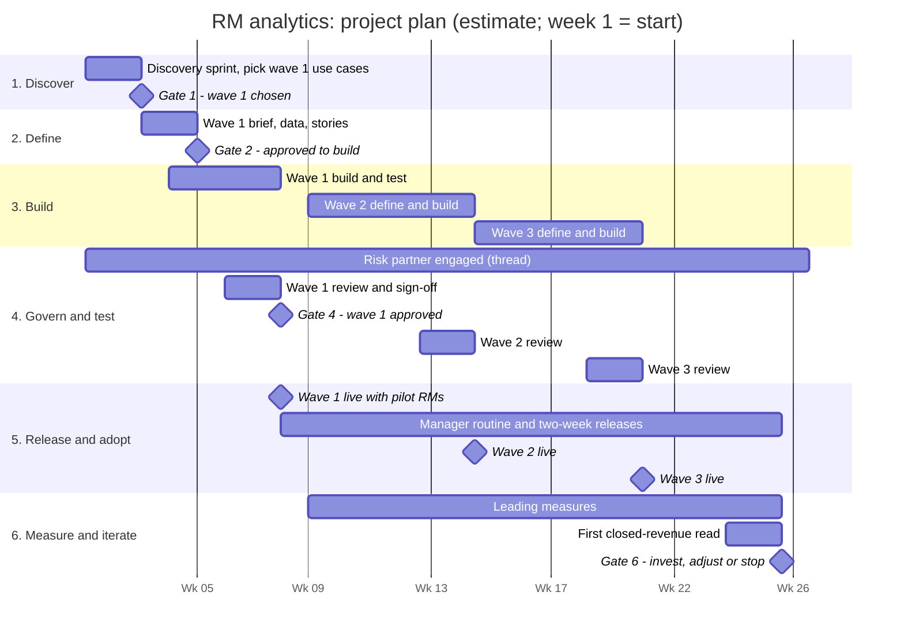

# AI-powered RM analytics: how I'd deliver the first use case

_Principal Applied AI Product Manager · Associated Bank · October 2026_

---

## Executive summary

**The outcome.** Give relationship managers (RMs) AI-powered insights that
help them generate new revenue, and free up the time they need to act on
those insights. The goal is a product that pays for itself and then some.

**The core assumption.** Much of what RMs need is standard across banks:
client briefs before meetings, meeting follow-ups, product-gap opportunities,
early warnings when a client may leave, and referral prompts. These can be
deployed quickly on platforms the bank already uses. They form the base, and
everything else is iterated and grown on top.

**The approach, in three points:**
1. **Deploy the standard base fast, aimed at revenue.** Pick the first standard use cases with the sponsor in a two-week sprint, then build them in weeks, not months.
2. **Pair insights with time.** RMs reportedly spend only about 25–30% of their time with clients. Better opportunities only pay off if RMs have time to act on them, so the base includes time savers (briefs, meeting follow-ups) alongside revenue insights.
3. **Govern from day one and prove it with evidence.** Risk partners are involved from the first week. Results are measured against RMs not yet using the tool, so revenue is never credited to AI by mistake.

**The plan (estimate):** the first standard use cases live with a pilot
group in about 6–8 weeks, then a release every two weeks and a new wave of use
cases about every six weeks. Leading measures show up within weeks; a first
read on closed revenue comes at about month 6. By day 90: wave 1 live with
regular releases, wave 2 about to launch, wave 3 in build.

**What I'd need:** a business sponsor, time with 6–10 RMs and their managers, named data owners, an early risk
partner, and a willing pilot group.

---

## Core assumption: a standard base, then iterate

Many RM use cases are standard across banks. Building these first, using
features already in Salesforce, Microsoft 365 Copilot and Power Platform, gets
value to RMs quickly and creates the base that later, more tailored use cases
build on. The menu below is a starting point; the sponsor and RMs pick and
order it in Discover.

| Wave (estimate) | Standard use case | Revenue lever or goal | Built mainly on |
|---|---|---|---|
| **Wave 1** (live about week 8) | Pre-meeting client brief | Time; all levers | Salesforce, Snowflake, Agentforce or M365 Copilot |
| | Meeting recap and follow-up draft | Time | M365 Copilot in Teams and Outlook |
| | Weekly opportunity list (product gaps) | Grow existing clients | Snowflake signals, Power Automate digest |
| **Wave 2** (live about week 15) | Early warning: client may leave | Keep clients | Snowflake signals, Salesforce |
| | Call notes into Salesforce (RM approves) | Time; better data | Salesforce Agentforce |
| | Referral prompts (for example, RM to treasury specialist) | Grow existing clients | Salesforce, Power Automate |
| **Wave 3** (live about week 21) | RM assistant ("what should I know about this client?") | Time; all levers | Salesforce Agentforce or Copilot Studio |
| | Prospect lookalikes | Win new clients | Snowflake, Salesforce |

**Why this works:** standard use cases on platforms the bank already runs
need less build and fit existing approvals. Each wave is low-risk and
internal-only: the AI suggests and drafts, and the RM decides. If the bank's
AI review applies to every new use, the review sets the real pace, which is
why the risk partner is involved from week one.

---

## 1. The outcome

The product has two goals that work together:

- **More revenue opportunities:** better insight into which clients to call, and why.
- **More time to act on them ("banker capacity"):** less time on meeting prep, call notes and CRM updates.

New revenue can come from three places. Finding out which is biggest is the
first job:

| Lever | What the AI looks for |
|---|---|
| **Win new clients** | Prospects that look like our best clients, and referrals from other parts of the bank |
| **Grow existing clients** | Clients who need a product they don't have yet, such as treasury management, including referrals between teams (for example, RM to treasury specialist) |
| **Keep clients** | Early signs a client may leave, such as falling balances or less activity |

---

## 2. The value model

The business case is built in Discover from real data. The structure is set
now, and the **[X]** values are filled in with the bank's numbers, not
invented here.

| Part | How it's calculated |
|---|---|
| **Revenue from insights** | RMs in scope [X] × qualified opportunities surfaced per RM per month [X] × share acted on [X]% × win rate [X]% × average first-year revenue per win [$X] |
| **Revenue from freed-up time** | RMs in scope [X] × hours saved per week [X] × share reinvested in client time [X]% → more client conversations, converted at today's rates |
| **Costs** | Licenses (for example, Copilot or Agentforce seats) + build effort + running costs (AI usage, data) + change management |
| **Net value** | Revenue above the comparison group, minus costs. Target payback: [X] months |

**How it's proven:** pilot RMs are compared with similar RMs not yet using
the tool, and every AI-sourced opportunity is tagged in Salesforce from day
one. Finance agrees the method before the pilot starts.

---

## 3. Who's involved and who decides

| Who | Role | Decides |
|---|---|---|
| **Business sponsor** (commercial banking leader) | Owns the outcome and the funding | Target lever, go/no-go at each gate |
| **RM leaders and market managers** | Shape the workflow; run the weekly routine | Pilot group, how insights are used in pipeline meetings |
| **Pilot RMs** | Co-design and test | Whether each insight is useful (their feedback steers the backlog) |
| **Product manager** (this role) | Owns discovery through adoption | Scope, priorities, trade-offs |
| **Data owners** (Snowflake, Salesforce) | Provide and certify data | What data may be used, and how |
| **Platform teams** (Salesforce, Microsoft, AWS, data engineering) | Build and run | Technical design within bank standards |
| **Model risk management** | Validates the AI | Risk rating; approval to launch |
| **Compliance** (including fair lending) and **privacy and security** | Review controls and data use | Required controls; sign-off |
| **Sales leadership and HR** | Incentives | Whether acting on insights is recognized |

---

## 4. How the work flows

Six steps, each ending in a **go/no-go gate**. The first pass through all six
is fast (about 6–8 weeks to wave 1 live); after that, steps 3–6 repeat in
two-week cycles, and each new wave of use cases takes a short pass through
Discover and Define. **Governance runs through every step**; Step 4 is the
formal approval gate, not the first time risk partners see the product.

| Step | Question it answers | Governance thread | Gate (go/no-go) |
|---|---|---|---|
| **1. Discover** | Which standard use cases come first, and which revenue lever matters most? | Risk partners briefed on the idea | Sponsor agrees on the wave 1 use cases, the target lever and the baseline |
| **2. Define** | What exactly do we build first, and how will we know it worked? | Risk intake and early rating; data use approved | Brief, data contract and risk rating agreed; value model shows payback within [X] months |
| **3. Build** | What's the smallest version RMs will use and trust? | Controls built in; test set created | Meets the quality bar (below) in testing |
| **4. Govern and test** | Is it safe, fair and controlled? | Formal validation and sign-offs | All sign-offs recorded; monitoring plan agreed |
| **5. Release and adopt** | Will RMs use it every week? | Live monitoring; incident process | At least [X]% of pilot RMs active weekly, at least [X]% of insights acted on, no high-severity incidents |
| **6. Measure and iterate** | Is it creating new revenue, and what comes next? | Ongoing model monitoring | Every wave: keep, change or stop each use case; quarterly: invest more, adjust or stop, based on results against the comparison group |

**Each step is described the same way:** Goal · Work (sub-steps and tools) ·
AI strategy (the agents) · AI for the team · AI for RMs · Data · Output ·
Checks · Gate.

---

## 5. How we deploy AI

**Principles for every agent:**
- **Two kinds of agents.** Some help the team do the work (*for the team*). Others are the product RMs use (*for RMs*).
- **Assistive first.** AI drafts or suggests; a named person decides. Autonomy grows only with evidence.
- **One job each.** A clear job, a short list of allowed actions, read-only by default, and a log of everything it does.
- **Built where the work happens.** Salesforce for client records, Teams and Outlook for daily work, AWS Bedrock and Snowflake for heavier AI and data.

**Choosing the platform.** The pilot picks one delivery platform, using five criteria:
1. Where RMs spend most of their day.
2. What data the product needs, and where it lives.
3. Fit with the bank's existing approvals and controls.
4. Cost model (per user vs. per use).
5. Speed to a working pilot.

**Starting point, to confirm in Discover:** if RMs work mainly in Salesforce,
show insights on the Salesforce client record (Agentforce, Prompt Builder),
with Snowflake as the data and signal engine. Send a weekly digest through
Teams or Outlook (Power Automate). Use one AI path for the pilot, and add AWS
Bedrock only where custom AI work is needed beyond what's built into
Salesforce. Every extra platform adds build work and another review.

**What ships when:** in waves of standard use cases (see *Core assumption*),
with a release every two weeks in between.

**The data flywheel.** The time-saving features (call notes and CRM updates
that RMs approve) also improve CRM data quality. Better data makes better
insights; better insights earn more use; more use produces more data. That
loop compounds over time and is a reason to build both goals together.

**The quality bar** (thresholds set in Define):
- **Accuracy:** every number in an insight matches the source data.
- **Sources:** every insight shows the data behind it.
- **Relevance:** pilot RMs rate insights as relevant at least [X]% of the time.
- **Usefulness:** RMs say they would act on at least [X]% of insights.
- **Permissions:** no RM ever sees a client they aren't allowed to see. Zero tolerance.

---

## Step 1: Discover

**Goal:** Which revenue lever is biggest, and what are RMs missing that would help them win it?

| Sub-step | What happens | Tools that help |
|---|---|---|
| 1. Frame the outcome | Agree with the sponsor on "new revenue," the three levers and the two goals | M365 Copilot in Word |
| 2. Size the levers | Estimate the dollars behind new clients, growth and keeping clients, including referrals | Salesforce (pipeline, win/loss), Snowflake (balances, products), Power BI |
| 3. Learn from RMs | Interview and shadow RMs and managers: how do they find opportunities today, and what gets in the way? | Teams meetings with M365 Copilot recaps; an approved LLM to find themes |
| 4. Map the RM's week | Where time goes, and how much is lost to admin | Salesforce activity data; M365 Copilot usage reporting |
| 5. Understand incentives | How RMs are measured and paid, and whether acting on insights would be rewarded | Conversations with sales leadership and HR |
| 6. Test reactions | Show RMs a rough mock-up of an "opportunity insights" screen | Power Apps |
| 7. Pick and baseline | Choose the wave 1 use cases from the standard menu and record today's numbers | Power BI |

**AI strategy:** Use AI to listen and size faster than a team could by hand. Nothing touches clients yet; a person checks every finding.

| Agent | Type | Job | Runs on | Reads from | Person in charge |
|---|---|---|---|---|---|
| Interview synthesizer | For the team | Turns interview recaps into themes and quotes, linked to each source | M365 Copilot, Copilot Studio | Teams transcripts, interview notes | PM reviews every theme |
| Opportunity sizer | For the team | Answers plain-English questions to size each lever | Snowflake Cortex Analyst | Snowflake balances and products; Salesforce pipeline | An analyst checks the numbers |
| Time-use analyst | For the team | Finds where RM time goes and which activities lead to won deals | Snowflake Cortex, Power BI | Salesforce activity and win/loss | PM confirms with RMs in person |

- **AI for the team:** themes from interviews; a first pass over pipeline and activity data.
- **AI for RMs:** nothing built yet; a mock-up to test reactions.
- **Data:** Salesforce pipeline and activity; client balances and products in Snowflake. Identify the data owners.
- **Output:** a ranked list of opportunities with sizes, the first target, the baseline, and a first value model.
- **Checks:** no client data in unapproved AI tools; risk partners briefed on the idea.
- **Gate:** the sponsor agrees on the wave 1 use cases, the target lever and the baseline.

---

## Step 2: Define

**Goal:** What exactly will we build first, for whom, and how will we know it worked?

| Sub-step | What happens | Tools that help |
|---|---|---|
| 1. Write the problem and outcome | One sentence each, with a measurable target | M365 Copilot in Word |
| 2. Choose the platform | Apply the five criteria and confirm the pilot platform | Salesforce, Copilot Studio, Power Automate |
| 3. Define the data contract | Exact fields, freshness and quality checks | Snowflake, Salesforce |
| 4. Start the risk intake | Describe the use case and get an early risk rating | The bank's governance process |
| 5. Write user stories and acceptance criteria | Short "as an RM, I need…" statements, each with a test of done | An approved LLM to draft; the team reviews |
| 6. Set the measures, quality bar and value model | Revenue, capacity and adoption targets; quality thresholds; payback | Power BI |
| 7. Agree attribution with Finance | How AI-sourced revenue is tagged and compared | Salesforce |
| 8. Scope the first release | The smallest useful version, and the pilot group | — |

**AI strategy:** Use AI as a drafting partner, so the team spends its time on decisions rather than documents. Nothing is approved by an agent.

| Agent | Type | Job | Runs on | Reads from | Person in charge |
|---|---|---|---|---|---|
| Requirements drafter | For the team | Drafts the problem statement, user stories and acceptance criteria | M365 Copilot in Word, or Copilot Studio | Discover findings | PM edits; team and sponsor approve |
| Data contract checker | For the team | Checks fields exist, are fresh and pass quality checks; flags gaps | Snowflake Cortex | Snowflake tables and their quality and access records | Data owner signs off |
| Risk intake assistant | For the team | Pre-fills the risk intake and flags likely high-risk areas | Copilot Studio agent grounded in bank policies | Policy documents, product brief | A risk partner sets the rating |

- **AI for the team:** drafting stories, criteria and test questions for review.
- **AI for RMs:** defined, not built. For example: "Each Monday, show me my top 5 client opportunities, with the reason and a suggested next step," and "Before each call, give me a one-page brief; afterward, draft my notes for Salesforce."
- **Data:** a signed-off data contract, so no feature depends on data we don't have.
- **Output:** a one-page product brief, a first backlog, the data contract, the risk rating and the value model.
- **Checks:** the AI plays no part in credit decisions or pricing. Any insight that suggests a credit product, such as a line of credit, is reviewed by compliance, because fair-lending rules (including the Equal Credit Opportunity Act) apply to business credit too.
- **Gate:** the brief, data contract and risk rating are agreed, and the value model shows payback within [X] months.

---

## Step 3: Build

**Goal:** Build the smallest version that RMs will actually use and trust.

| Sub-step | What happens | Tools that help |
|---|---|---|
| 1. Prepare the data | Trusted views of client signals: balance trends, product gaps, activity | Snowflake; Fabric and Power BI to explore |
| 2. Find the opportunities | Simple, explainable rules and scores first. AI explains them; it doesn't invent them | Snowflake (Cortex), AWS Bedrock |
| 3. Write the "why" and next step | An LLM turns each signal into a plain-English reason and talking points | Salesforce Prompt Builder or AWS Bedrock |
| 4. Deliver it where RMs work | On the client record, plus a weekly digest in Teams or Outlook | Salesforce Agentforce, Power Automate |
| 5. Free up RM time | Wave 1: pre-meeting briefs and meeting follow-ups. Wave 2: call notes into Salesforce, approved by the RM | M365 Copilot (Teams recaps), Salesforce Agentforce |
| 6. Show the source | Every insight links to the numbers behind it | Built into the design |
| 7. Capture feedback | One click to accept, reject or change each insight, with a reason when rejected | Salesforce, Power Automate |
| 8. Build the test set | Real client examples with known good answers, graded by experienced RMs | AWS Bedrock model evaluation |

**AI strategy:** This is where the RM-facing agents are built: a small team of single-purpose agents, read-only by default, with the RM approving anything that changes a record or reaches a client.

| Agent | Type | Job | Runs on | Reads from | Person in charge |
|---|---|---|---|---|---|
| Signal finder | For RMs | Scans each RM's clients overnight for opportunity signals using explainable rules and scores | Snowflake (Cortex) | Snowflake balances, products, trends | Business owns the rules; no client contact |
| Insight writer | For RMs | Turns each signal into a plain-English reason and talking points, citing the numbers | Salesforce Prompt Builder or AWS Bedrock | Signal finder output; Salesforce client record | The RM decides whether to act |
| Prep and follow-up assistant (waves 1–2) | For RMs | Drafts a pre-call brief, then call notes and follow-ups | Salesforce Agentforce or M365 Copilot | Salesforce client record; Teams meeting recap (with client consent where recorded) | The RM approves before anything is saved or sent |
| RM assistant (wave 3) | For RMs | Answers "what should I know before my call with this client?" | Salesforce Agentforce or a Copilot Studio agent in Teams | Salesforce and Snowflake, read-only, only the RM's permitted clients | Any record update needs the RM's click |
| Test grader | For the team | Scores every version against the test set and the quality bar | AWS Bedrock model evaluation | Test set, product outputs | Experienced RMs grade a sample |

- **AI for the team:** drafting prompts and test questions; checking every version against the test set.
- **AI for RMs:** wave 1: pre-meeting briefs, meeting follow-ups and the weekly opportunity list, with one-click feedback. Later waves add the next standard use cases. Assistive only.
- **Data:** live connections from Snowflake and Salesforce; each RM sees only clients they're already allowed to see.
- **Output:** a working product in a test environment, the test results and an evidence pack started.
- **Checks:** filters that block sensitive data and off-topic answers (Bedrock Guardrails, Salesforce Einstein Trust Layer); every AI action logged; client consent for any recorded meeting.
- **Gate:** meets the quality bar in testing.

---

## Step 4: Govern and test (formal approval gate)

**Goal:** Prove the product is safe, fair and controlled, so the bank can approve it.

| Sub-step | What happens | Tools that help |
|---|---|---|
| 1. Confirm the risk rating | Register the product in the model inventory and confirm its rating | The bank's model risk framework (in line with SR 11-7 guidance) |
| 2. Review data and privacy | Confirm what client data the AI sees, and why it's allowed | Snowflake (Horizon access rules and masking) |
| 3. Gather testing evidence | Accuracy, rate of made-up answers, and red-teaming (trying to break it) | AWS Bedrock model evaluation |
| 4. Check fairness | Are opportunities, especially credit-related ones, spread fairly across client segments and regions? | Snowflake, Power BI |
| 5. Confirm controls | Human approval before anything reaches a client; guardrails; audit logs | Bedrock Guardrails, Einstein Trust Layer, Power Platform environments and data rules |
| 6. Confirm vendor reviews | Third-party risk reviews for the vendors involved | The bank's vendor risk process |
| 7. Get sign-offs | Risk, compliance, privacy and security | — |

**AI strategy:** Use AI to test harder and document faster, but never to approve. Risk partners make every call.

| Agent | Type | Job | Runs on | Reads from | Person in charge |
|---|---|---|---|---|---|
| Red-team agent | For the team | Generates thousands of tricky requests (another RM's clients, a credit decision) to try to break the product | AWS Bedrock | The product in test | Risk reviews every failure |
| Fairness monitor | For the team | Checks opportunities are spread fairly across segments and regions | Snowflake, Power BI | Opportunity outputs, client segments | Compliance reviews results |
| Evidence pack assembler | For the team | Compiles test results, data use and controls into review documents | M365 Copilot in Word | Test results, data contract, controls | PM and risk verify every claim |

- **AI for the team:** red-teaming at scale; assembling the evidence pack.
- **AI for RMs:** no change; the product is frozen for review.
- **Data:** proof that data use matches what was approved.
- **Output:** an approved product and an agreed monitoring plan.
- **Checks:** no surprises, because risk partners have been involved since Discover.
- **Gate:** all sign-offs recorded and the monitoring plan agreed.

---

## Step 5: Release and adopt

**Goal:** Get RMs using it every week, starting with a pilot.

| Sub-step | What happens | Tools that help |
|---|---|---|
| 1. Launch the pilot | A small group of RMs and their managers, alongside a comparison group | Power Platform environments (test to live), Salesforce release |
| 2. Build it into routines (the core of adoption) | Managers run weekly pipeline meetings from the insights, so use becomes a habit, not a training topic | Salesforce, Power BI |
| 3. Train in context | Short demos built on RMs' own clients | Teams |
| 4. Recruit champions | Respected RMs who show peers how they use it | A Teams channel |
| 5. Recognize AI-sourced wins | Celebrate and credit wins that started from an insight | Salesforce, sales leadership |
| 6. Fix fast | Act on feedback every week | Feedback logged in Salesforce |
| 7. Scale in waves | Expand only after a go/no-go check | Power BI adoption dashboard |

**AI strategy:** Adoption is a management routine, not a training event; research suggests training rarely sticks and use fades. AI helps RMs learn in the flow of work and turns feedback into fixes quickly.

| Agent | Type | Job | Runs on | Reads from | Person in charge |
|---|---|---|---|---|---|
| Onboarding coach | For RMs | Answers "how do I use this?" inside Teams | Copilot Studio agent in Teams | Training guides, FAQs | Product team keeps content current |
| Weekly opportunity digest | For RMs | Sends each RM their top opportunities every Monday | Power Automate with the insight writer | Signal finder and insight writer outputs | The RM decides what to pursue |
| Feedback triage | For the team | Sorts feedback into bugs, quality issues and ideas, and routes it to the backlog | Power Automate with an approved LLM | Feedback logged in Salesforce | PM sets priorities |

- **AI for the team:** summarizing pilot feedback and spotting patterns.
- **AI for RMs:** the live product, still assistive.
- **Data:** usage, feedback and AI-sourced opportunities flowing into dashboards.
- **Output:** pilot results and a scale decision.
- **Checks:** live monitoring; every issue has an owner and an escalation path.
- **Gate:** at least [X]% of pilot RMs active weekly, at least [X]% of insights acted on, and no high-severity incidents.

---

## Step 6: Measure and iterate

**Goal:** Prove it creates new revenue, and keep making it better.

**Leading and lagging measures.** Commercial deals often take months to
close, so each wave is judged first on *leading* measures (insights acted on,
opportunities and pipeline created, client time gained), visible within
weeks. *Lagging* measures, meaning closed revenue against the comparison
group, get a first read at about month 6 and firm up over the following
quarters.

| Type | Measure |
|---|---|
| **Adoption** | Weekly active RMs; share of the target group using it |
| **Capacity** | Client-facing hours per RM; clients covered per RM |
| **Action** | Insights acted on; new opportunities created from them in Salesforce |
| **Business impact** | Pipeline and closed revenue from AI-sourced opportunities, against the comparison group |
| **Quality** | Accuracy, relevance and usefulness against the quality bar |
| **Risk and controls** | Incidents, RM overrides, guardrail blocks |
| **Cost** | Cost per active RM and per acted-on insight |

| Sub-step | What happens | Tools that help |
|---|---|---|
| 1. Track the measures | Live dashboards | Power BI and Fabric, Salesforce reports, Snowflake |
| 2. Compare with the baseline | Pilot RMs vs. the comparison group | Power BI |
| 3. Re-test after every change | Re-run the test set; watch for quality slipping over time ("drift") | AWS Bedrock model evaluation |
| 4. Review monthly | With the sponsor: keep, change or stop | — |
| 5. Feed the next wave | Choose and order the next standard use cases | — |

**AI strategy:** Use AI to watch the product continuously and explain results in plain English, so decisions rest on evidence.

| Agent | Type | Job | Runs on | Reads from | Person in charge |
|---|---|---|---|---|---|
| Impact analyst | For the team | Answers "how much pipeline came from AI insights this month?" against the comparison group | Snowflake Cortex Analyst, Power BI | AI-tagged Salesforce opportunities; Snowflake | Analytics validates before reporting |
| Quality watchdog | For the team | Re-runs the test set after every change and alerts on drift | AWS Bedrock model evaluation, Power Automate | Test set, live outputs, feedback | Product owner decides to fix or roll back |
| Improvement scout | For the team | Proposes the next backlog items or next lever from usage and feedback | M365 Copilot or Copilot Studio | Dashboards, feedback, reviews | PM and sponsor decide |

- **AI for the team:** impact analysis, quality monitoring and improvement ideas.
- **AI for RMs:** a better product with each release.
- **Data:** AI-sourced opportunities tagged in Salesforce from day one.
- **Output:** a monthly impact report and an updated backlog.
- **Checks:** ongoing monitoring under the model risk framework.
- **Gate:** every wave, keep, change or stop each use case; each quarter, invest more, adjust or stop, based on results against the comparison group.

---

## 6. The project plan (estimate)

A fast first pass to wave 1, then two-week iteration cycles, with a new wave
of standard use cases about every six weeks. The risk partner is engaged from
week one. Weeks are estimates; the real pace depends on data access and the
bank's AI review, confirmed in the first weeks.

| Step | Weeks (estimate) | Ends with |
|---|---|---|
| **1. Discover** | 1–2 (short sprints before later waves) | Gate 1: wave 1 use cases, target lever, baseline |
| **2. Define** | 3–4 | Gate 2: brief, data contract, risk rating; approved to build |
| **3. Build** | Wave 1: 4–7; wave 2: 9–14; wave 3: 15–20 (each goes live the week after) | Gate 3: each wave meets the quality bar in testing |
| **4. Govern and test** | Thread from week 1; a short review before each wave | Gate 4: each wave approved to launch |
| **5. Release and adopt** | Wave 1 live about week 8, then a release every two weeks | Gate 5: each wave meets its adoption targets |
| **6. Measure and iterate** | Leading measures from week 9; closed revenue read about month 6 | Gate 6: invest more, adjust or stop |

**By day 90 (about week 13):** wave 1 is live with pilot RMs and shipping
every two weeks, wave 2 is in final review, wave 3 is starting, and leading
measures are coming in.

---

## 7. Top risks and how I'd handle them

| Risk | How I'd handle it |
|---|---|
| **CRM data is incomplete** (RMs skip logging) | Lean on account data in Snowflake first; the time-saving features improve CRM data over time (the flywheel) |
| **RMs don't trust the insights** | Show the reason and the numbers behind every insight; co-design with pilot RMs; managers model use |
| **Governance takes longer than planned** | Brief risk partners in week one; keep each wave low-risk, internal-only and on approved platforms; build the evidence pack as we go |
| **Incentives don't reward acting on insights** | Agree recognition for AI-sourced wins with sales leadership before launch |
| **Costs grow with usage** | Track cost per active RM; use the smallest AI model that meets the quality bar |
| **Revenue attribution is disputed** | Agree the comparison-group method and tagging with Finance in Define |
| **Data access takes longer than planned** | Request access in week 1; start with data that's already certified; keep the first release's data needs small |
| **Client privacy in recorded meetings** | Client consent and the bank's recording policy apply; notes are drafts until the RM approves |

---

## 8. Built to reuse

The first use case builds parts the next one can use:
- **Data:** trusted client-signal views in Snowflake.
- **Quality:** test sets and an automated way to grade AI output.
- **Controls:** guardrail settings, logging and the evidence-pack template.
- **Agents:** proven patterns for signal finding, insight writing and prep.
- **Adoption:** the manager-routine and champions playbook.

Each later use case should start faster and pass governance more easily.

---

## 9. What other banks are doing

A web scan (October 2026) found the same basic pattern at other banks:
signals from data, shown inside the CRM, with the reason visible and the RM
in control. Most published numbers are vendor or bank claims rather than
controlled results, so treat them as directional.

| Who | What they did | Source |
|---|---|---|
| BMO (commercial banking) | "Next Best Offer" engine surfaces client opportunities to relationship teams through the CRM | [BMO AI][bmo] |
| Bank of America | AI tools reportedly let relationship bankers cover far more clients (about 15 → about 50 in some cases) | [TechInformed][boa] |
| Morgan Stanley (wealth) | "Debrief" writes meeting notes and follow-ups into Salesforce, with client consent; a referral program reportedly produced over 100,000 successful referrals | [Quartz][ms1], [The Daily Upside][ms2] |
| JPMorgan (wealth) | "Coach" AI tools credited with lifting sales during the April 2025 market selloff | [Reuters via AOL][jpm] |
| Banco do Brasil | AI summaries inside the RM workspace, logged back to the CRM | [NICE case study][bdb] (vendor) |
| CaixaBank | Salesforce Agentforce and Data Cloud for AI-assisted product contracting | [CaixaBank][caixa] |

**Industry figures (directional):**
- Banks that rework a frontline area end to end report about 3–15% higher revenue per RM and 20–40% lower cost to serve ([McKinsey][mck]).
- RMs spend about 25–30% of their time in client conversations; training is infrequent and adoption of new tools fades ([McKinsey][mck], via [Backbase][bb]).

**What this approach takes from it:** pair insights with freed-up time; track
clients covered per RM; make adoption a management routine; capture why RMs
reject insights; include internal referrals; and prove results against a
comparison group, which is rare in published results.

[mck]: https://www.mckinsey.com/industries/financial-services/our-insights/agentic-ai-is-here-is-your-banks-frontline-team-ready
[bmo]: https://ai.bmo.com/?p=569
[boa]: https://techinformed.com/?p=37424
[ms1]: https://qz.com/morgan-stanley-openai-debrief-ai-chatbot-genai-1851561076
[ms2]: https://www.thedailyupside.com/technology/artificial-intelligence/how-morgan-stanleys-ai-helped-close-100k-new-clients-this-year/
[jpm]: https://www.aol.com/news/jpmorgan-says-ai-helped-boost-170825172.html
[bdb]: https://www.nice.com/resources/banco-do-brasils-bankers-stopped-working-yesterdays-data-and-let-ai-hand-them-todays
[caixa]: https://www.caixabank.com/en/headlines/news/caixabank-and-salesforce-collaborate-to-personalise-customer-experience-in-banking-services-through-ai
[bb]: https://www.backbase.com/blog/how-ai-is-transforming-relationship-manager-productivity-in-commercial-banking

---

## 10. What I'd confirm in the first weeks

This approach is built on the platforms named in the role: Salesforce,
Snowflake, Microsoft Fabric and Power BI, Microsoft 365 Copilot, Power
Platform and AWS Bedrock. I'd expect to build on them, and I'd confirm early:

- Which revenue lever matters most to the business right now?
- How will success be judged in the first 6 months?
- Which RM teams would make a good pilot group?
- Who owns the client data in Snowflake and Salesforce?
- How are RMs measured and rewarded today?
- How long does AI governance review usually take?
- What team and budget are available for the pilot?
- Which of these platforms are live for RMs today, and which are planned?
